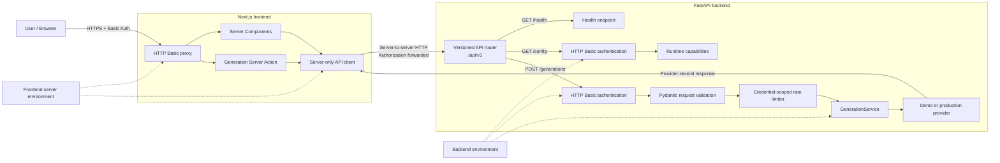
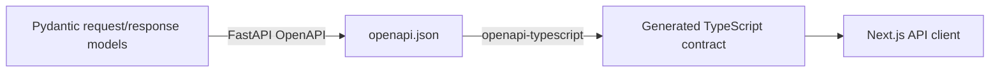

# Architecture

The browser never calls FastAPI directly. Next.js revalidates authentication
inside protected server operations rather than relying on the proxy alone. The
backend is therefore private and does not carry browser CORS configuration.

FastAPI owns the wire contract. The committed schema and generated TypeScript
make cross-language changes explicit and are checked by the test suite.
