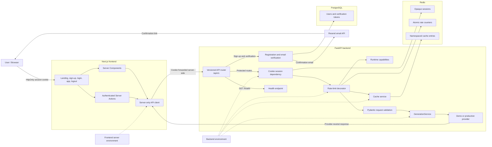
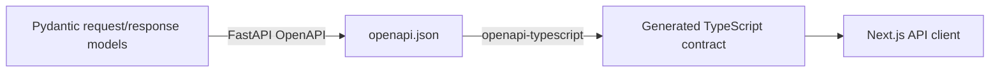

# Architecture

Next.js owns the browser cookie and forwards it through a server-only client.
FastAPI resolves every protected session from Redis near the endpoint. Proxy
redirects are an optimistic user experience check and are not an authorization
boundary.

FastAPI owns the wire contract. The committed schema and generated TypeScript
make cross-language changes explicit and are checked by the test suite.
